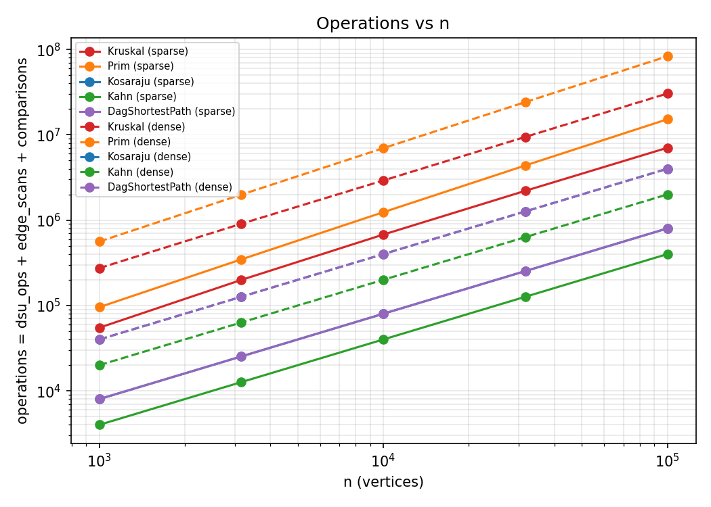
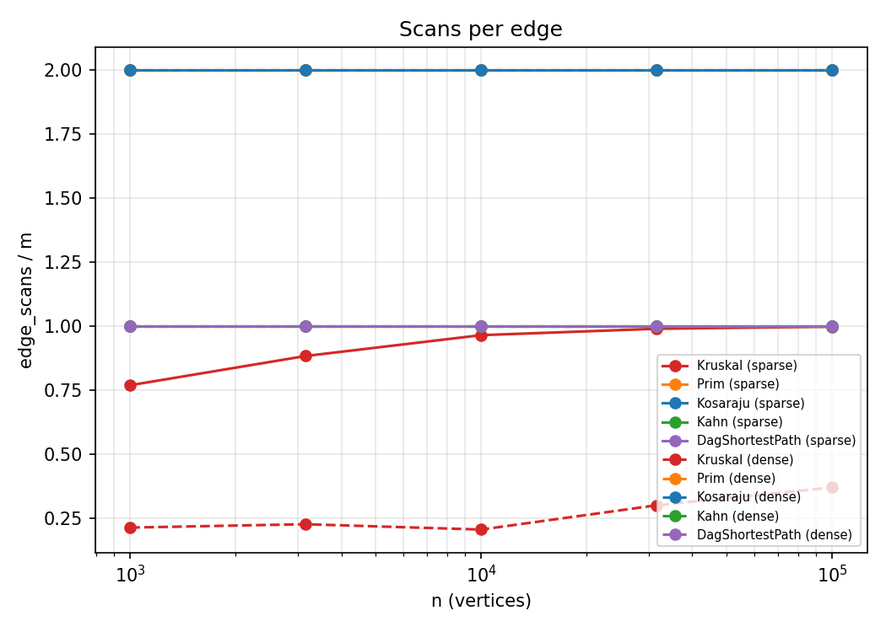
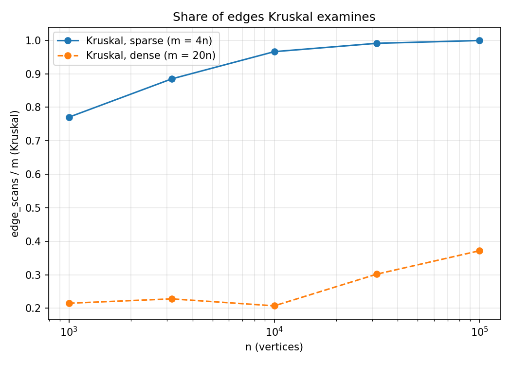

# Assignment 3 — Graphs: DSU, MST, SCC and Shortest Paths

All numbers below come from `results/results.csv` (counters, same seed, reproducible) and `scripts/plots.py`.
The benchmark reproduces all 10 reference values of the assignment (MST weight, SCC count, sum of DAG distances) exactly.

## 1. Complexity table

| Algorithm | Time | Extra space | Why |
|---|---|---|---|
| DSU `find` / `union` | O(α(n)) amortized | O(n) | union by rank keeps trees shallow, path compression flattens them; α(n) ≤ 4 for any realistic n |
| Kruskal | O(E log E) | O(E + V) | sorting E edges dominates; E log E = O(E log V); DSU adds only O(E α(V)) |
| Prim (binary heap, lazy) | O(E log E) = O(E log V) | O(E + V) | every edge is pushed at most twice, each push/pop costs O(log E); heap may hold stale entries |
| Kosaraju | O(V + E) | O(V + E) | two DFS passes, each touches every vertex and edge once; reversed graph costs O(V + E) |
| Kahn | O(V + E) | O(V) | every vertex is queued once, every edge is scanned once when its source leaves the queue |
| DAG shortest paths | O(V + E) | O(V) | one pass over the topological order, every edge relaxed once (+ O(V+E) for the order itself) |

## 2. Counters vs formulas

The ratio counter / formula must stay constant as n grows (columns: n = 1 000, 3 162, 10 000, 31 623, 100 000).

| Algorithm | Ratio | Density | n=1k | 3.2k | 10k | 31.6k | 100k |
|---|---|---|---|---|---|---|---|
| Kosaraju | edgeScans / E | both | 2.000 | 2.000 | 2.000 | 2.000 | 2.000 |
| Kosaraju | edgeScans / (V+E) | sparse | 1.600 | 1.600 | 1.600 | 1.600 | 1.600 |
| Kosaraju | edgeScans / (V+E) | dense | 1.905 | 1.905 | 1.905 | 1.905 | 1.905 |
| Kahn | edgeScans / E | both | 1.000 | 1.000 | 1.000 | 1.000 | 1.000 |
| DAG shortest paths | edgeScans / E | both | 1.000 | 1.000 | 1.000 | 1.000 | 1.000 |
| Prim | edgeScans / E | both | 2.000 | 2.000 | 2.000 | 2.000 | 2.000 |
| Prim | comparisons / (E log2 E) | sparse | 1.829 | 1.865 | 1.895 | 1.921 | 1.934 |
| Prim | comparisons / (E log2 E) | dense | 1.825 | 1.847 | 1.866 | 1.878 | 1.890 |
| Kruskal | comparisons / (E log2 E) | sparse | 0.891 | 0.907 | 0.869 | 0.809 | 0.745 |
| Kruskal | comparisons / (E log2 E) | dense | 0.903 | 0.846 | 0.784 | 0.720 | 0.666 |
| Kruskal | dsuOps / E | sparse | 2.290 | 2.519 | 2.682 | 2.732 | 2.748 |
| Kruskal | dsuOps / E | dense | 0.580 | 0.606 | 0.565 | 0.754 | 0.894 |
| Kruskal | dsuOps / edgeScans | sparse | 2.972 | 2.848 | 2.776 | 2.757 | 2.751 |
| Kruskal | dsuOps / edgeScans | dense | 2.697 | 2.657 | 2.723 | 2.497 | 2.403 |

Reading the table:

* **Kosaraju, Kahn, DAG, Prim scans** are exactly proportional to E (2E, E, E, 2E). Kosaraju's ratio to V+E is constant for a fixed density (the two densities differ because m/n differs).
* **Prim comparisons** are about 1.8–1.9 · E log2 E: each edge enters the heap from both endpoints (2E pushes), so the constant ≈ 2 with a slow drift from the heap's real depth. The class O(E log E) is confirmed.
* **Kruskal comparisons** are below E log2 E (the sort is faster than the worst case) and slowly decrease; the class O(E log E) holds as an upper bound.
* **Kruskal dsuOps / E** is not flat on dense graphs, because Kruskal stops as soon as the tree has n−1 edges and examines only 21–37 % of the edges (section 6). The right normaliser is the number of scanned edges: **dsuOps / edgeScans stays in 2.4–3.0** (each scanned edge costs 2 finds; a successful union adds 2 more finds and 1 union, so the ratio is about 2 + 3(n−1)/scanned). This is the DSU's almost-constant cost per operation.

## 3. Slope check (log-log, edgeScans vs n)

| Curve | Slope |
|---|---|
| Kosaraju, Kahn, DAG shortest paths, Prim (sparse and dense) | **1.000** |
| Kruskal, sparse | **1.055** |
| Kruskal, dense | **1.119** |

A slope of 1 means linear work. Kruskal is slightly steeper because the share of edges it must examine grows with n (0.77 → 0.999 on sparse graphs), which is the sort/connectivity effect behind the E log E term.

## 4. Correctness arguments

**Cut property (Kruskal and Prim).** Let (S, V∖S) be any cut and let e be a lightest edge crossing it. Take any MST T. If e ∉ T, adding e to T creates a cycle, and this cycle crosses the cut at least twice, so it contains another crossing edge f ≠ e. Replacing f by e gives a spanning tree whose weight is ≤ w(T), because w(e) ≤ w(f); so some MST contains e, i.e. e is safe. Kruskal takes the globally lightest edge that joins two different components: for the cut "component of u versus the rest" this edge is the lightest crossing edge (all lighter edges were already examined and lie inside components), so it is safe. Prim keeps a tree S and always takes the lightest edge leaving S, which is by definition the lightest edge of the cut (S, V∖S), so it is safe too. By induction on the number of added edges, the set built so far is always part of some MST, and after n−1 edges it is one. With ties the trees may differ but the total weight is the same, which is what the benchmark checks.

**Induction on the topological order (DAG shortest paths).** Number the vertices in topological order v1, …, vn; every edge goes from a smaller to a larger index. Claim: when vi is taken out of the order, dist[vi] is the true shortest distance from the sources. Base: v1 has no incoming edges, so it is a source and dist = 0. Step: every path into vi ends with an edge (vj, vi), j < i, and by the induction hypothesis dist[vj] is already final when vj was processed; at that moment the edge (vj, vi) was relaxed, so dist[vi] ≤ dist[vj] + w for every predecessor, and dist[vi] always equals the length of some real path. Hence dist[vi] equals the minimum over all paths. Each edge is relaxed exactly once, so one pass of O(V + E) is enough. Negative weights are safe because the argument never uses the sign of a weight, only the order; there are no cycles, so there is no negative cycle. In a general graph Dijkstra's greedy choice fails (a later negative edge can improve a vertex that was already finalised), there is no topological order to process, and a negative cycle makes the shortest path undefined — there Bellman-Ford is needed.

## 5. Which algorithm when

| Situation | Choice | Why |
|---|---|---|
| MST, edges come as a list, sparse (E ≈ V) | Kruskal | sort + DSU, no adjacency structure needed; O(E log E) |
| MST, adjacency list, sparse | Kruskal (Prim also fine) | measured: Kruskal did fewer comparisons than Prim (5.5 M vs 14.4 M at n = 100 000) |
| MST, adjacency list, E = 20V (our "dense") | Kruskal | examines only 21–37 % of edges, 27.9 M vs 79.1 M comparisons at n = 100 000 |
| MST, truly dense graph (E ≈ V²), matrix | Prim with an array instead of a heap, O(V²) | no sort of ~V² edges; not implemented here, which is why heap-Prim loses in our numbers |
| Components must be tracked while edges arrive | DSU | O(α(n)) per operation |
| Directed graph, cycles possible, need groups of mutually dependent jobs (deadlocks) | Kosaraju | SCCs in O(V + E), 2E scans |
| Directed graph, only need "is there a cycle / a valid order?" | Kahn | one pass, E scans, reports the cycle instead of a wrong order |
| Directed graph without cycles, shortest or fastest route | Kahn + DAG relaxation | O(V + E), negative weights allowed |
| Graph with cycles and non-negative weights | Dijkstra (not in this assignment) | DAG relaxation needs an order that does not exist |
| Graph with cycles and negative weights | Bellman-Ford | also detects negative cycles; O(VE) |

## 6. Share of edges Kruskal examines

Kruskal stops after n−1 tree edges. `edgeScans / m`:

| | n=1k | 3.2k | 10k | 31.6k | 100k |
|---|---|---|---|---|---|
| sparse (m = 4n) | 0.770 | 0.885 | 0.966 | 0.991 | 0.999 |
| dense (m = 20n) | 0.215 | 0.228 | 0.207 | 0.302 | 0.372 |

On sparse graphs almost every edge is needed (few alternatives, the heaviest MST edge is close to the heaviest edge overall), so Kruskal's saving is small. On dense graphs many cheap alternatives exist, so the last MST edge is found early and 63–79 % of the edges are never looked at. Prim cannot skip edges: it always scans 2E adjacency entries. This explains where each MST algorithm wins.

## 7. Plots

(In the scans-per-edge plot Prim and Kosaraju lie on the same line at 2, Kahn and DAG on the same line at 1, and sparse/dense coincide for them.)

## 8. A word about time

Median of 5 runs on one machine, JVM not specially warmed up. At n = 100 000: Kruskal 90 ms (sparse) / 334 ms (dense), Prim 380 / 2 884 ms, Kosaraju 176 / 483 ms, Kahn 25 / 80 ms, DAG shortest paths 18 / 75 ms. On the two smallest graphs the clock is mostly noise (single-digit milliseconds, JIT warm-up). Wall-clock time depends on the CPU, the JVM version, garbage collection and background load, so another laptop will give other numbers; the operation counters do not, and all conclusions above are drawn from the counters. The times only agree with them in direction (Kahn/DAG fastest, heap-Prim slowest on dense graphs).

## 9. Not done

Bonus tasks A (Tarjan) and B (condensation and critical path) were not implemented.
